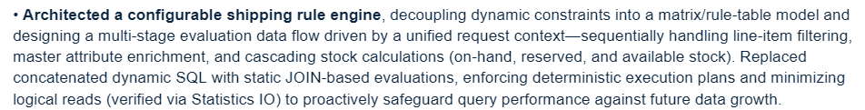
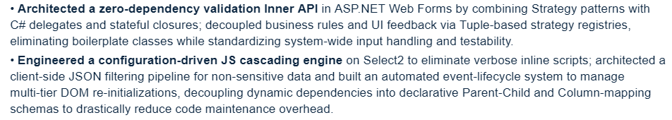

<style>
  /* 作用於整篇正文區域，統一為中文字型棧 */
  article, .post-content, main, body {
    font-family: -apple-system, BlinkMacSystemFont, "Segoe UI", "PingFang SC", "Hiragino Sans GB", "Microsoft YaHei", sans-serif !important;
    -webkit-font-smoothing: antialiased;
  }

  /* 針對程式碼區塊單獨保證等寬字型 */
  code, pre {
    font-family: Consolas, "Courier New", monospace !important;
  }
</style>




## 一、 背景

1. **业务演进导致原有逻辑失效**：老方案的预订库存计算逻辑最初是正确的，但随着业务不断演化，部分数据表的使用方式和字段语义发生了变化，导致原有的计算逻辑逐渐失真，预订库存的结算方式最终出现偏差、无法满足当前业务。
    
2. **Team Leader 建议**：趁修复此次 Bug 的契机，看看整体是否有更优的写法。
    

## 二、 现有方案缺点

### 1. 数据库引擎层面的物理痛点

- **缺乏可观测性**：动态 SQL 拼接导致查询结构多变，无法生成稳定的查询指纹（Query Hash），生产环境下的执行耗时、调用频次等性能指标难以按单一功能进行聚合追踪。   
  
- **潜在执行计划漂移风险（Plan Drift）**：面对不同过滤条件的动态组合，优化器容易出现基数估算（Cardinality Estimation）偏差，存在执行计划异常跳变、导致查询耗时剧烈抖动的潜在风险。
    
- **执行计划缓存膨胀（Plan Cache Bloat）**：动态拼接导致查询的谓词结构（Query Shape）存在大量不同组合，为每种条件组合都编译了独立的一次性执行计划，持续占用并浪费内存。
    
- **物理 I/O 穿透隐患**：随着未来业务数据量扩展，失真的执行计划和不可控的查询存在击穿内存缓存、引发大量物理磁盘读取的潜在风险。
    

### 2. 软件工程与维护层面的架构痛点

- **隐式上下文泛滥**：接手者无法区分“真实业务规则”与“历史遗留 Bug”。
    
- **单个业务逻辑的结构性割裂**：在大单体 SQL 的语法机制下，单个完整的业务规则被强制拆散，一部分散落在 `JOIN ... ON` 谓词中，一部分嵌在 `WHERE` 过滤分支里，甚至混杂在 `SELECT` 的 `CASE WHEN` 表达式中。这种语法骨架带来的碎片化极度消耗开发者的工作记忆。
    
- **低级排查盲区与测试阻力**：动态 SQL 的单引号拼接与转义难以通过肉眼静态排查，手滑失误极易漏网，且代码无法进行清晰确定的分支单元测试。


## 三、 核心架构思路与设计原则

1. **业务约束边界显性化**：
    - 动手前首先抽取全部业务规则，清晰厘清系统所需满足的硬性业务约束全集。
    
2. **谓词关系的集合化改写**：
    - 鉴于关系数据库引擎对集合操作（`JOIN`）的执行效率显著优于逐行分支判定，尽可能将过程式 `WHERE` 判定改写为基于规则表/驱动表的 `JOIN`。
    
3. **职责边界归位（Separation of Logical and Physical）**：
    
    - 开发者清楚全链路业务上下文，负责主动规划全局数据流向与物化边界；
        
    - 数据库优化器缺乏业务全局感知，将其求解空间严格限制在局部子集内，专职负责局部物理执行路径的优化。
        
4. **统一输入上下文（Unified Request Context / `@ctx`）**：
    - 将外部传入的离散参数收敛为单一可信数据源（SSOT: Single Source of Truth），统一完成默认值赋予与参数标准化，避免下游计算逻辑直接依赖外部离散输入，同时为调试与边界值验证提供唯一的校验切入点。
        
5. **分阶段物化流水线（三层表变量载体）**：
    
    - 核心数据流划分为三层，采用表变量（`@TableVariable`）承载各阶段中间态，方便下游阶段直接读取，并提供清晰的断点调试观察口：
        
        - **Layer 1: Line-item Filtering（明细项过滤）**：依托统一 `@ctx` 过滤有效计算明细；
            
        - **Layer 2: Master Attribute Enrichment（主数据属性补全）**：明细对齐展开规则，补全主数据与关联维度；
            
        - **Layer 3: Cascading Stock Calculations（级联库存计算）**：联动结算现存（On-hand）、预订（Reserved）及可用（Available）库存。
## 四、 架构推导过程與數理模型的後驗對齊

1. **架构推导心智模型**：
 - 架构推导的本质是把全量业务约束同时装进脑海，通过多维约束的交叉涌现与隐性剪枝（Implicit Pruning），直接收敛至拓扑最优解，因此架构构思耗时极短。
        
2. **数学视角的后验对齐（事后调查与理论映射参考）**：

 - 在完成整套重构并复盘代码机制时，进一步调查发现，系统中的具体工程实现恰好在不同维度上对应了数理逻辑与抽象代数的形式化概念。個人覺得世界的本質是數學，如果一個設計不糟糕必然符合一定的數學原理。（以下仅作理论映射参考,本人也在學習中）：

   - 数据定义层: 集合论的外延定义（通过全展开表预先将业务规则集合实例化）
   - 全局架构层: 范畴论中的射之复合（通过传递 @ctx 构建无副作用的 3 层纯函数式流水线）
   - 关系与属性层: 直积空间与一阶谓词逻辑（通过行值构造器就地实例化局部元组并执行谓词限制 $\sigma$）
   - 控制流调停层: 偏序集与格论中的极值演算（基于良序/偏序关系实现优先级回退与最终原因提取）

## 五、 系统整体执行框架

1. **前置规矩层 (Rule & Matrix Layer)**：静态业务约束与多维映射关系。
    
2. **统一上下文 (Unified Request Context / `@ctx`)**：标准化入参解析与过滤基准。
    
3. **三层计算执行流水线 (Three-tier Runtime Pipeline)**：
    
    - Layer 1: 明细筛选与基数收敛
        
    - Layer 2: 维度补全与主数据关联
        
    - Layer 3: 级联库存分层展开与合算
        
4. **最终汇总计算 (Final Aggregation)**：基于上下文与仓库分类输出最终结算库存和各种字段。
    
5. **后置过滤器 (Post-calculation Filter)**：针对阶段计算完成后的派生字段执行二次判定（如判断“是否可以出荷 / 可发货”）。
    

## 六、 核心机制落地与可观测性实践

### 1. 规矩层（Rule / Matrix Model）

- **仓库合算规则的“配置-铺平”机制**：
    
    - **表 1（人工维护规则表）**：维护原始业务维度，如定义仓库 Tag（Tag 1=主仓库 1特征1、Tag 2=主仓库 1特征2、Tag 3=商家仓库 1特征1、Tag 4=商家仓库 1特征2）及资材匹配属性；
        
    - **表 2（自动铺平展开表）**：系统在元数据更新时自动将表 1 的多维规则全量铺平成映射展开表，将潜在的条件分支彻底拉平为静态映射关系。人工只维护表 1，系统自动生成表 2。
        
    - **运用场景**：
        
        - 消除下游 `IF/ELSE` 分支，直接通过确定性 `JOIN` 批量完成集合求解；
            
        - 便于测试与对账：计算时优先执行**全量铺平计算**，直观观测各细分分支合算明细；随后按 Tag 汇总合算；最后结合上下文输出最终库存。
            
- **配送 Matrix 多维区间匹配**：
    
    - 废弃无业务语义的 `-1 / 0 / 1` 隐式标志位，改用连续闭合区间（`[min, max]`）定义物理范围；
        
    - **运用场景**：
        
        1. 配合统一 `@ctx` 判定所适用的配送规则；
            
        2. 通过区间与驱动表 `JOIN` 高效过滤合规资材。
            

### 2. 计算层（Calculation Layer）

- **利用 `APPLY` 优先度表匹配特性**：
    
    - 使用 `CROSS APPLY` / `OUTER APPLY` 结合动态/静态优先度规则，快速选取最优资材特性，具备极高的扩展性；
        
    - 相同机制复用于后续业务判定中，例如快速确定并提取“出荷不可（不可发货）的具体理由”。
        

### 3. 调试与健壮性保障（Debugging & Observability）

- **`SET STATISTICS IO` 配合 AI 现学与调优**：
    
    - 初版完成后开启 `SET STATISTICS IO` 逐段监控；
        
    - 当时只知道有该排查手段但并不清楚如何具体解读指标，通过向 AI 提问现学了指标含义，查清了“逻辑读取（Logical Reads）”的具体物理机制；
        
    - 依据掌握的指标特征，对读开销异常的算子进行微调（如调整驱动顺序、消除冗余全表扫描），实证压缩逻辑读，防范未来数据扩容风险。
        
- **全局 `TRY...CATCH` 与 SQL 上下文捕获**：
    
    - 采用全局 `TRY...CATCH` 结构包裹执行逻辑；
        
    - 发生异常时，捕获当前运行时的 **SQL 执行上下文**，直接吐出出问题的具体 SQL 代码块以及对应的报错问题；
        
    - 避开了原生报错中“行号对应不上/难以检索”的痛点，凭吐出的代码块与错误描述，直接锁定是哪一小块 SQL 发生了什么问题。


## 七、 团队沟通与工程权衡

### 1. 表别名规范（Aliasing）

- **认知碰撞与思考演进**：
    
    - **老方案依赖机械别名（`a-z`）**：原系统是大单体查询，横跨十余张表连接。在极端膨胀的作用域下，必须依靠 `a, b, c...z` 机械别名防止重名，本质上是给混乱的大作用域打补丁；
        
    - **引擎化消除别名必要性**：重构后采用分层流水线，单层作用域极短、实体少。此时直接使用原表名（或业务名词）具备更强的领域自解释性，无需接手者在上下文中检索“表 `d` 到底代表什么”；
        
- **落地选择**：
    
    - 当时关于重构命名的考量尚未完全定型，遵循组内提出的设想，沿用了既有的别名习惯。
        

### 2. 排序位置（Sort）

- **认知碰撞**：
    
    - 最初在 SQL 内部利用临时表（`#TempTable`）做确定性排序；
        
    - 组内规避使用临时表，认为临时表“会一直留在缓存里”。当时对此说法存疑（感觉不太可能）但由于当时的自己缺乏能够验证和判断底层机制的充分知识，選擇遵从团队的决定。
        
- **落地选择**：
    
    - 搁置在 SQL 内用临时表排序的方案，采纳组内建议，将排序移交到应用代码端执行。
        

### 3. 中间态载体选择（Storage）

- **认知碰撞**：
    
    - 组内规矩统一要求使用表变量（`@TableVariable`）；
        
    - 调研对比了表变量与临时表的底层差异（如统计信息支持等），但未发现具有压倒性说服力的证据能证明在当前场景下临时表显著更好；
        
- **落地选择**：
    
    - 严格遵守团队既有规约，维持使用表变量承载各阶段中间态。


## 八、 技术细节：无 `CASE WHEN` 范式（`APPLY` + `VALUES` 的三种重塑模式）

针对多分支判断与动态取值，全面摒弃深层嵌套的 `CASE WHEN`，统一采用 `CROSS APPLY` / `OUTER APPLY` 结合行构建器（`VALUES`）将过程式逻辑转化为集合操作。在实际落地中，抽象为三种不同的数据流重塑模式：

### 1. 结构层：行构造器驱动的局部元组化（Inline Tupling / Column-to-Row Inversion）

- **机制与实现**：
    
    - 将宽表中单行的横向多列 Schema，解构并旋转为纵向的 `(MatchTag, Val)` 元组行；
        
    - 动态业务条件不再作为逐行分支的选取判断，而是作为该虚拟集合的静态等值连接（`JOIN` / `WHERE`）谓词。
        
- **模式代码**：
    
    ```sql
    CROSS APPLY (
        SELECT c.Val
        FROM (
            VALUES 
                ('TAG_A', d.ColA),
                ('TAG_B', d.ColB)
        ) c(MatchTag, Val)
        WHERE c.MatchTag = @ctx.RequiredTag
    ) resolved
    ```
    
- **对应数学原理与理论模型**:
  - **集合论**：笛卡尔积上的元组构造与外延定义（Cartesian Product & Extensional Definition）:
    针对定义域 $D_{\text{Tag}} \times D_{\text{Val}}$ 的直积空间，利用行值构造器（`VALUES`）对外延元素进行显式罗列，在局部作用域内直接实例化二元关系（虚拟元组集合）。
  - **一阶谓词逻辑**：映射为限制算子（First-Order Predicate Restriction $\sigma$）:
    剔除过程式条件跳转（`CASE WHEN`），将取值逻辑还原为针对局部元组集合应用一阶谓词限制算子（$\sigma_{c.\text{MatchTag} = @\text{ctx}.\text{RequiredTag}}$），回归标准关系代数运算。
  - **代数系统**：关系代数的闭包性（Relational Closure Property）:
    将跨列取值的动作严格封闭在 `APPLY` 局部的子关系运算内，确保输入、中间过程与输出始终保持在关系（元组集合）闭包之中，对外层模式保持正交透明。      

### 2. 状态层：多数据源降级与优先级仲裁（Priority Fallback Pipeline）

- **机制与实现**：
    
    - **Layer 2 预先打标**：结合资材属性与配送方式，在流水线前序阶段提前推导出计算所需的业务 Tag；
        
    - **Layer 3 仲裁收敛**：利用 `APPLY (VALUES ...)` 将不同事实源构造为带序候选集 `(Priority, SourceVal)`，通过定序提取首项，平铺决策树：
        
        - **优先级 1**：明细表原生记录的仓库（物理明确指定）；
            
        - **优先级 2**：Layer 2 打标推导出的目标属性（规则默认推导）。
            
- **运用场景**：
    
    - 判定该笔预订库存是否计入当前计算范围；
        
    - 将“有指定按指定走，没指定按规则走”的多层嵌套判定，平铺为确定性的优先级行集选取，避免在聚合统计中嵌入深层 `IF...ELSE`。
        

### 3. 領域層：出荷不可判因映射與提取（State-to-Reason Projection）

- **機制與實現**：
    
    - 承接 Layer 3 計算出的各項校驗狀態，利用 `APPLY (VALUES ...)` 映射為帶優先級的理由行集：
        
- **模式代码**：

    ```sql
        OUTER APPLY (
            SELECT TOP 1 Reason
            FROM (
                VALUES 
                    (IsStockShort,  '在庫不足', 1),
                    (IsInvalidAttr, '資材屬性不符', 2)
            ) r(IsHit, Reason, Priority)
            WHERE r.IsHit = 1
            ORDER BY r.Priority
        ) unship_reason
    ```
- **運用場景**：
    
    - 當明細判定為「出荷不可」時，按優先級直接提取首要的未滿足項作為展示理由；
        
    - 校驗判定與文本展示清晰分離，增改文案或優先級時不影響核心計算流水線。


## 九、最後

1. 各種術語如果有用錯的地方請不要客氣的指正我，用術語只是爲了盡量准確的表達和傳遞信息，并不是我真的對概念駕輕就熟。
2. 還有另外兩個案例想復盤，大致内容如下。


1. 在找工作，有興趣可以聯係我。這是我的[領英](https://www.linkedin.com/in/liu-shutong)。

[def]: image.png